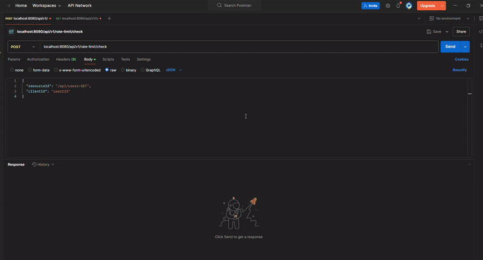
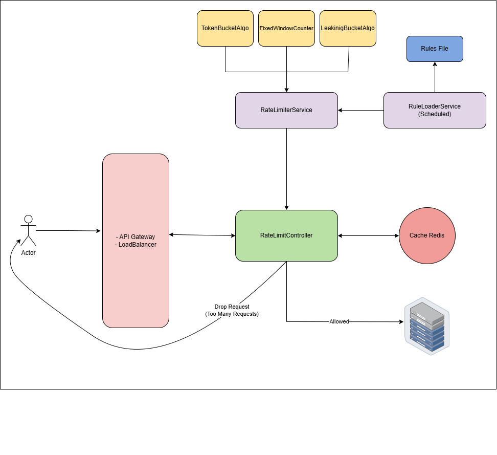
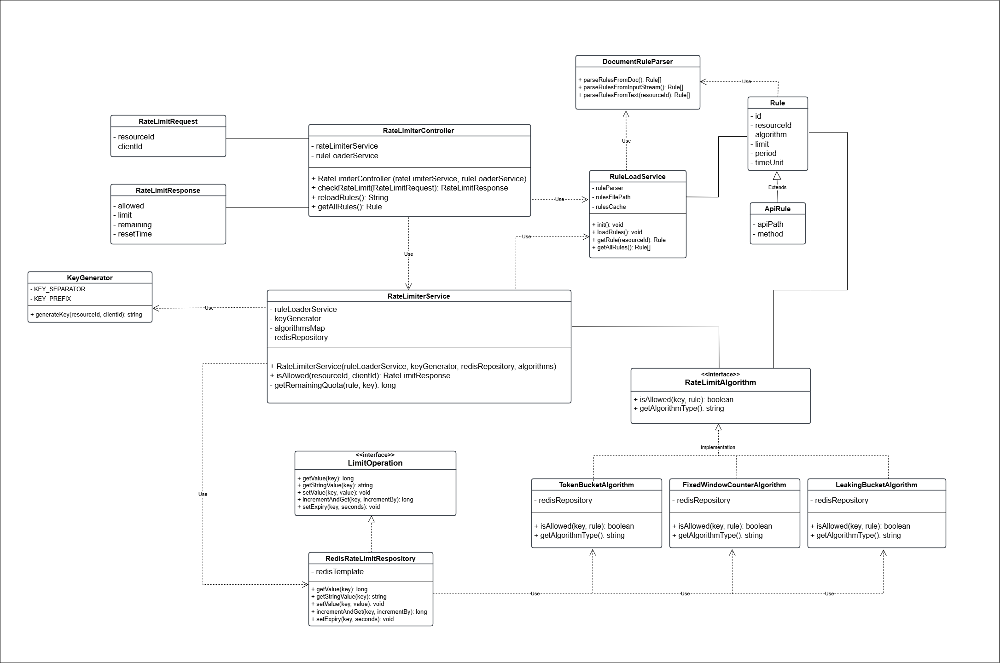

# Design Rate Limiter

A standalone, distributed rate limiter service for Java Spring Boot applications that supports multiple rate limiting algorithms and uses Redis for high-performance quota tracking.

<p align="center">
  
  
  
  
</p>

## Demo


## High Level Design


## Class Diagram


## Features
- **Multiple Rate Limiting Algorithms**:
  - **Token Bucket**: Bursty traffic support with steady-rate token replenishment.
  - **Leaking Bucket**: Smooths out traffic spikes at a constant processing rate.
  - **Fixed Window Counter**: Time-window based counting with automatic key expiration.
- **Distributed & High Performance**: Powered by Redis for atomic increments and TTL-based expiration.
- **Dynamic Rule Configuration**: Reads and parses rules directly from DOCX files (`src/main/resources/rules.docx`) using Apache POI.
- **Scheduled Rule Reloading**: Automatically reloads rules every hour, with an API endpoint for instant reload.
- **Interactive Documentation**: Integrated Swagger/OpenAPI UI for live API testing.

---

## Prerequisites
- **Java**: JDK 17 or higher
- **Redis**: Running locally on `localhost:6379` (or configured via `application.properties`)

---

## Getting Started

### 1. Start Redis
Using Docker:
```bash
docker run -d --name redis-ratelimiter -p 6379:6379 redis:alpine
```
Or via Homebrew (macOS):
```bash
brew services start redis
```

### 2. Run the Application
Set `JAVA_HOME` to your JDK 17 installation and run using the Maven wrapper:

```bash
export JAVA_HOME="/opt/homebrew/opt/openjdk@17"   # Adjust path to your JDK 17
./mvnw spring-boot:run
```

Alternatively, build and run the executable JAR:
```bash
./mvnw clean package -DskipTests
java -jar target/RateLimiter-0.0.1-SNAPSHOT.jar
```

The service will start on port `8080`.

---

## API Usage

### 1. Check Rate Limit
Checks if an incoming request for a client and resource is permitted under current quotas.

- **URL**: `POST /api/v1/rate-limit/check`
- **Headers**: `Content-Type: application/json`
- **Request Body**:
  ```json
  {
    "resourceId": "/api/users:GET",
    "clientId": "user123"
  }
  ```
- **Response (HTTP 200 - Allowed)**:
  ```json
  {
    "allowed": true,
    "limit": 2,
    "remaining": 1,
    "resetTime": 1792862324
  }
  ```
- **Response (HTTP 429 - Limit Exceeded)**:
  ```json
  {
    "allowed": false,
    "limit": 2,
    "remaining": 0,
    "resetTime": 1792862324
  }
  ```

---

### 2. Get All Active Rules
Returns all loaded rate limit rules currently in memory.

- **URL**: `GET /api/v1/rate-limit/rules`
- **Response**:
  ```json
  [
    {
      "id": "rule-1",
      "resourceId": "/api/users:GET",
      "algorithm": "TOKEN_BUCKET",
      "limit": 2,
      "period": 5,
      "timeUnit": "SECONDS"
    },
    {
      "id": "rule-2",
      "resourceId": "/api/users:POST",
      "algorithm": "LEAKING_BUCKET",
      "limit": 2,
      "period": 5,
      "timeUnit": "SECONDS"
    },
    {
      "id": "rule-3",
      "resourceId": "/api/products:GET",
      "algorithm": "FIXED_WINDOW_COUNTER",
      "limit": 2,
      "period": 5,
      "timeUnit": "SECONDS"
    }
  ]
  ```

---

### 3. Reload Rules On Demand
Forces an immediate reload of rules from `rules.docx` without restarting the application.

- **URL**: `POST /api/v1/rate-limit/rules/reload`
- **Response**:
  ```text
  Rules reloaded successfully
  ```

---

## Swagger / OpenAPI Documentation
Once the application is running, explore and test the endpoints directly via Swagger UI:
- **URL**: [http://localhost:8080/swagger-ui/index.html](http://localhost:8080/swagger-ui/index.html)

---

## Integration with an Application Gateway

To integrate this rate limiter with a Spring Boot API Gateway or client service:

```java
@Service
public class ApiGatewayService {
    
    @Autowired
    private RestTemplate restTemplate;
    
    @Value("${rate.limiter.url:http://localhost:8080/api/v1/rate-limit}")
    private String rateLimiterUrl;
    
    public boolean isRequestAllowed(String apiPath, String method, String clientId) {
        String resourceId = apiPath + ":" + method;
        RateLimitRequest request = new RateLimitRequest(resourceId, clientId);
        
        try {
            ResponseEntity<RateLimitResponse> response = restTemplate.postForEntity(
                rateLimiterUrl + "/check", request, RateLimitResponse.class);
                
            return response.getBody() != null && response.getBody().isAllowed();
        } catch (HttpClientErrorException.TooManyRequests ex) {
            return false;
        } catch (Exception ex) {
            // Fallback strategy: allow request or block based on requirements
            return false;
        }
    }
}
```
